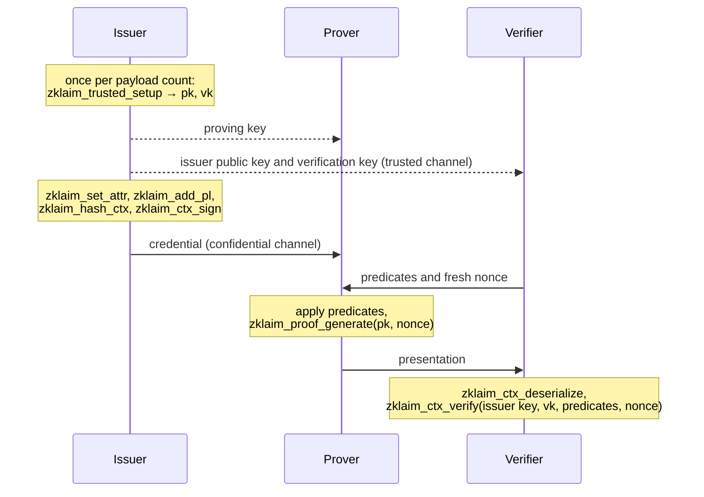

# Concepts

zklaim lets an issuer certify numeric attributes of a holder, and lets the holder prove statements about those attributes to verifiers without revealing them. A verifier learns that, for example, a date of birth lies before 2008-01-01, but not the date itself.

## Roles

| Role | Does | Holds |
| --- | --- | --- |
| Issuer | Runs the trusted setup, signs commitments to the holder's attributes | Ed25519 signing key, setup keys |
| Prover | Holds a credential and generates proofs for verifier requests; the API calls the holder the prover | Credential with attribute values and salts, proving key |
| Verifier | Requests a predicate, checks the presentation | Trusted issuer public key and verification key |

## Payloads and attributes

A credential contains one or more payloads (at most 2³² − 1). Each payload holds five attributes and a 15-byte random salt. Attributes are unsigned 64-bit integers; applications map dates, enumerations, or hashed strings to integers themselves.

The commitment to a payload is the SHA-256 hash of its 55-byte pre-image: the five attributes as 8-byte big-endian integers, followed by the salt. The salt hides low-entropy attributes: without it, a verifier could hash every plausible date of birth and compare. 55 bytes is the longest input that SHA-256 pads into a single block, so the circuit needs one compression per payload.

## Predicates

A predicate assigns each attribute an operation and a 64-bit reference value. The statement for one attribute is `attribute OP reference`, compared as unsigned integers.

| Operation | Holds if | Wire code |
| --- | --- | --- |
| `zklaim_less` | attribute < reference | 1 |
| `zklaim_less_or_eq` | attribute ≤ reference | 3 |
| `zklaim_eq` | attribute = reference | 2 |
| `zklaim_greater_or_eq` | attribute ≥ reference | 10 |
| `zklaim_greater` | attribute > reference | 8 |
| `zklaim_not_eq` | attribute ≠ reference | 9 |
| `zklaim_noop` | always; the reference is ignored | 99 |

Every attribute of every payload has exactly one operation. A request therefore consists of one `zklaim_predicate` per payload, five references and five operations each. Unused slots use `zklaim_noop`. To prove a range such as 18 ≤ age ≤ 65, the issuer must store the value in two attribute slots.

The verifier chooses the predicates. The issuer does not sign them: the references and operations in an issued credential are placeholders that the prover overwrites with the verifier's request before proving.

## Credentials and presentations

The library uses one structure, `zklaim_ctx`, for both message kinds:

- A credential travels from the issuer to the prover. It contains the commitments, the issuer's public key and signature, and the witnesses: the attribute values and salts. It must be sent over a confidential channel and stored like a secret. `zklaim_ctx_serialize_credential` writes it.
- A presentation travels from the prover to a verifier. It contains the commitments, the predicates, the issuer's public key and signature, and the proof, but no witnesses. `zklaim_ctx_serialize` writes it and never includes witnesses.

`zklaim_ctx_deserialize` reads both kinds. The [wire format](wire-format.md) specifies the bytes.

## Issuer signature

The issuer signs the list of commitments with Ed25519 (RFC 8032), prefixed with a protocol domain, the version, the curve, and the payload count. The signature covers neither the predicates nor the verification key. Verifiers check it against an issuer public key they obtained through a trusted channel, never against the key embedded in the message.

## Trusted setup

zklaim's proofs are Groth16 zk-SNARKs. Groth16 requires a setup per circuit, which produces a proving key and a verification key. The circuit depends only on the payload count, so an issuer runs `zklaim_trusted_setup` once per payload count it supports and reuses the keys for every credential with that count.

- The proving key is large (about 25 MB per payload) and goes to provers.
- The verification key is small (a few kilobytes). Verifiers pin it per issuer and payload count, like the issuer public key.

The setup is not bound to an issuer key; any party could run it. Whoever runs it can forge proofs for its circuit, so verifiers must trust that party. For an issuer-run setup, that is the issuer, who is trusted to issue credentials anyway.

## Nonce

Every request carries a fresh 32-byte random nonce chosen by the verifier. The nonce is part of the proof's public input, so a presentation proved for one nonce fails verification for every other. A verifier that receives a presentation cannot replay it to another verifier.

## Protocol flow

The [developer guide](guide.md) implements each step. [Security](security.md) describes what a successful verification establishes and what it does not.
